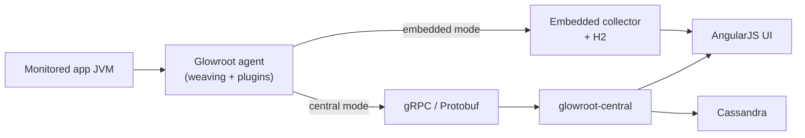

# Glowroot product map (as on `main`)

This page describes **what the repository on `main` is**, not a roadmap.
Use it to orient before changing code or writing more docs.

Glowroot is a Java APM: an agent captures traces/metrics from a monitored JVM;
data is stored and shown either **in-process (embedded)** or on a **central
collector**.

## Deploy modes

| Mode | What runs | Storage | UI |
|------|-----------|---------|-----|
| **Embedded** (default) | `-javaagent` in the app JVM | Local H2 (same JVM) | HTTP UI in the same JVM (default port `4000`) |
| **Central** | `-javaagent` on each app JVM + `glowroot-central` on a monitor host | Cassandra (central) | HTTP UI served by central |

Embedded JSON/H2 storage is **not** a substitute for Central when you need many
agents, shared UI, or long retention.

Requirements on `main`: **Java 8+** agent, **Java 17+** central.

## Data path (runtime)

Rough sequence:

1. Agent bytecode weaving (`@Pointcut` plugins + core) records traces, aggregates, profiles.
2. **Embedded:** agent writes to local H2; UI reads from that process.
3. **Central:** agent sends via `wire-api` Protobuf over gRPC to `glowroot-central`; central persists in Cassandra, rolls up metrics, serves the same UI assets.

## Repository layout (top level)

Full page: **[repository-layout.md](repository-layout.md)** (every top-level
directory, Maven reactor vs folders, what belongs where).

| Path | Role |
|------|------|
| [`agent/`](../agent/) | Agent implementation, plugins, embedded collector, distribution packaging |
| [`central/`](../central/) | Central collector process (gRPC server, Cassandra repos, rollups, alerts, UI servlet) |
| [`wire-api/`](../wire-api/) | Shared Protobuf / gRPC contracts |
| [`common/`](../common/), [`common2/`](../common2/) | Shared config, model, utilities |
| [`ui/`](../ui/) | AngularJS 1.x SPA (Grunt build; assets packaged into agent/central) |
| [`webdriver-tests/`](../webdriver-tests/) | Selenium browser integration tests |
| [`docs/`](./) | In-repo documentation (this tree) |
| [`.github/`](../.github/) | CI workflows and build scripts |
| [`build/`](../build/), [`skills/`](../skills/) | Build helpers; optional `glowroot-ops` skill |

Operator-facing install prose that is **not** duplicated here lives on the
[wiki](https://github.com/glowroot/glowroot/wiki).

## Agent modules (`agent/`)

Full page: **[agent-modules.md](agent-modules.md)** (APIs, core, embedded,
plugins, shaded vs unshaded, dist, tests).

| Module / area | Role |
|---------------|------|
| `api`, `plugin-api`, `bytecode-api` | Public APIs for plugins and weaving |
| `core` | Agent runtime: weaving (ASM), trace collection, config |
| `embedded` | Embedded collector + local H2 storage |
| `plugins/*` | Instrumentation plugins |
| `shaded/*` | Shaded third-party JARs under `org.glowroot.agent.shaded.*` |
| `it-harness` | Integration-test harness (custom classloader or `-javaagent`) |
| `dist` | Distribution zip (`glowroot-*-dist.zip`) |
| `ui-sandbox` | Local sandbox that generates sample traces for UI work |

**Agent entry:** `org.glowroot.agent.MainEntryPoint` (javaagent).

## Central (`central/`)

Full page: **[central.md](central.md)** (boot wiring, gRPC, `repo/`, util,
v09 support).

| Concern | Where (indicative) |
|---------|---------------------|
| Process entry | `org.glowroot.central.Main` → `CentralModule` |
| Agent ingest | gRPC `CollectorService` / related services |
| Persistence | Cassandra repositories under `org.glowroot.central.repo` |
| Aggregation | `RollupService` and related jobs |
| Alerting | `CentralAlertingService`, `HeartbeatAlertingService` |
| UI HTTP | Servlet + static UI assets (same SPA as embedded) |
| Schema bootstrap | `create-schema` command on `Main` |

Central shaded HTTPS native bits live under `agent/shaded/central-https-*` for
packaging; the runnable collector is the `central` Maven module.

## Wire API (`wire-api/`)

Full page: **[wire-api.md](wire-api.md)** (services, message protos,
compatibility rules).

Protobuf definitions used by agent ↔ central (and shared models), including:

`AgentConfig`, `Aggregate`, `CollectorService`, `Common`, `DownstreamService`,
`Profile`, `Trace`.

## UI (`ui/`)

Full page: **[ui.md](ui.md)** (SPA areas, `layout.central`, Java `*JsonService`,
Grunt build).

Single AngularJS SPA shared by embedded and central. Build uses Node / Bower /
Grunt (installed under `ui/` on first Maven build). Dev proxy:
`./grunt serve` → UI on `:9000`, API proxied to a local sandbox/central
(typically `:4000`).

## Tests (how verification is organized)

| Kind | Location / convention |
|------|------------------------|
| Unit tests | `*Test.java` in modules |
| Agent ITs | `*IT.java` via `agent/it-harness` |
| Browser ITs | `webdriver-tests` |
| CI phases | `.github/scripts/build.sh` / GitHub Actions Build workflow |

## Key entry points (code)

| Mode | Class |
|------|--------|
| Agent (javaagent) | `org.glowroot.agent.MainEntryPoint` |
| Central process | `org.glowroot.central.Main` |
| UI sandbox (dev) | `org.glowroot.agent.ui.sandbox.UiSandboxMain` (`agent/ui-sandbox`) |

## What this map deliberately omits

- Step-by-step install (wiki).
- Plugin pointcut tutorials (wiki + existing plugin sources).
- Features **not** on `main` yet (do not document speculative storage backends here).
- Fork-local notes under personal `doc/` trees — not part of upstream `docs/`.

## Related in-repo notes

See [docs/README.md](README.md) for the short index of topic notes already on
`main` (health endpoints, H2 upgrade, allocated-memory column, 0.14.8 notes).
